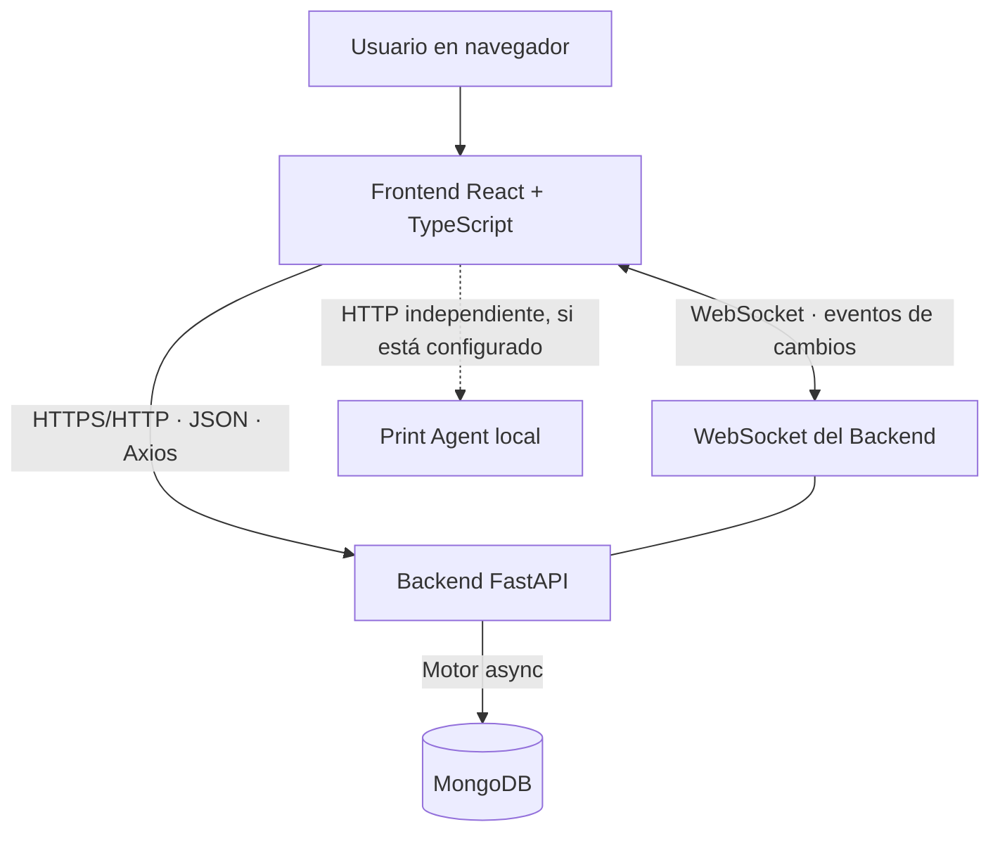

<div align="center">

# 🍣 Boutique de Sabores
### Sistema integral de gestión para una tienda de sushi artesanal

**Frontend · API REST · MongoDB · Actualización en tiempo real**


</div>

---

## 📌 Índice

- [Descripción](#-descripción)
- [Arquitectura e integración](#-arquitectura-e-integración)
- [Tecnologías](#-tecnologías)
- [Funcionalidades](#-funcionalidades)
- [Estructura del repositorio](#-estructura-del-repositorio)
- [Requisitos previos](#-requisitos-previos)
- [Configuración e instalación](#-configuración-e-instalación)
- [Variables de entorno](#-variables-de-entorno)
- [Comunicación entre Frontend y Backend](#-comunicación-entre-frontend-y-backend)
- [Autenticación y seguridad](#-autenticación-y-seguridad)
- [Actualizaciones en tiempo real](#-actualizaciones-en-tiempo-real)
- [Documentación de la API](#-documentación-de-la-api)
- [Resolución de problemas](#-resolución-de-problemas)
- [Documentación complementaria](#-documentación-complementaria)

---

## 🧾 Descripción

**Boutique de Sabores** es una aplicación web de gestión orientada a una tienda de sushi artesanal. El proyecto separa la interfaz de usuario de la API y de la persistencia de datos: el **Frontend** presenta las pantallas y coordina la interacción; el **Backend** valida y procesa las operaciones; **MongoDB** conserva la información.

El sistema contempla la administración de productos, promociones, comandas, caja, movimientos de caja, movimientos de stock, usuarios, autenticación, configuración operativa y registro de actividad. La interfaz utiliza una inicialización central para cargar los datos principales y una conexión WebSocket para propagar cambios entre clientes.

> **Alcance:** esta documentación se preparó a partir del código incluido en el ZIP entregado. Las direcciones, credenciales y valores de despliegue dependen del entorno real y deben configurarse localmente; no se deben publicar secretos.

## 🧩 Arquitectura e integración



### Responsabilidad de cada componente

| Componente | Responsabilidad |
|---|---|
| **Frontend** | Renderizar las pantallas, validar formularios, administrar el estado de la interfaz y llamar a los servicios HTTP. |
| **Backend / FastAPI** | Exponer endpoints, validar datos con esquemas, aplicar reglas de negocio, autorizar operaciones y responder en JSON. |
| **MongoDB** | Persistir productos, promociones, comandas, caja, movimientos, usuarios y demás colecciones utilizadas por la API. |
| **WebSocket** | Notificar cambios de recursos a clientes conectados para mantener las vistas sincronizadas. |
| **Print Agent** | Servicio separado que el Frontend puede consultar para impresión. Su funcionamiento depende de su propia instalación y configuración; no es el mismo proceso que la API de gestión. |

### Flujo típico de una operación

1. El usuario realiza una acción en una pantalla (por ejemplo, crea una comanda).
2. El Frontend ejecuta la función del servicio correspondiente.
3. Axios envía una solicitud HTTP a la URL configurada en `VITE_API_URL`.
4. FastAPI autentica la solicitud, valida los datos y ejecuta el servicio de negocio.
5. El Backend lee o escribe en MongoDB.
6. La API devuelve el resultado al Frontend.
7. En las operaciones que emiten eventos, el Backend difunde el cambio por WebSocket para actualizar otras sesiones.

**Importante:** WebSocket complementa las solicitudes HTTP; no reemplaza la persistencia ni convierte una operación fallida en exitosa.

## 🛠️ Tecnologías

### Frontend
- React 19 y TypeScript.
- Vite como servidor de desarrollo y herramienta de compilación.
- React Router para navegación.
- Redux Toolkit y React Redux para estado compartido.
- Axios para solicitudes HTTP.
- Formik y Yup para formularios y validaciones.
- styled-components para estilos encapsulados.

### Backend
- Python y FastAPI.
- Pydantic / pydantic-settings para validación y configuración.
- Motor y PyMongo para la conexión con MongoDB.
- JWT y utilidades de hash de contraseñas para autenticación.
- Uvicorn para ejecutar la API.
- WebSocket para eventos en tiempo real.

## ✨ Funcionalidades incluidas en el código

- Inicio de sesión, renovación de token y consulta de usuario autenticado.
- Recuperación de contraseña mediante código y flujo de restablecimiento.
- Gestión de productos y promociones.
- Gestión de comandas.
- Gestión de caja y movimientos de caja.
- Registro y ajuste de movimientos de stock, incluido ajuste masivo reservado a administración.
- Administración de usuarios con permisos de administrador.
- Configuración operativa.
- Registro de actividad/auditoría.
- Sincronización de cambios mediante WebSocket.
- Integración opcional con Print Agent desde el Frontend.

La disponibilidad exacta de acciones y permisos depende de los endpoints, esquemas y rol del usuario autenticado.

## 📁 Estructura del repositorio

```text
BoutiqueSabores-v2.0/
├── README.md                  # Este documento: integración global
├── BackEnd/
│   ├── app/
│   │   ├── api/routes/        # Endpoints REST
│   │   ├── api/dependencies/  # Dependencias de autenticación/autorización
│   │   ├── config/            # Configuración del entorno
│   │   ├── database/          # Conexión, índices y datos iniciales
│   │   ├── repositories/      # Acceso a datos
│   │   ├── schema/            # Modelos y validación
│   │   ├── services/          # Reglas de negocio
│   │   ├── websocket/         # Eventos en tiempo real
│   │   └── main.py            # Aplicación FastAPI
│   └── requirements.txt
└── FrontEnd/
    ├── src/
    │   ├── components/        # Pantallas y componentes
    │   ├── initialization/    # Inicialización de sesión y datos
    │   ├── services/          # Clientes HTTP y servicios
    │   ├── store/             # Redux Toolkit
    │   ├── interfaces/        # Tipos TypeScript
    │   └── main.tsx
    ├── package.json
    └── vite.config.ts
```

## ✅ Requisitos previos

- Python compatible con las dependencias fijadas en `BackEnd/requirements.txt`.
- Node.js y npm compatibles con la versión de Vite del proyecto.
- Una instancia accesible de MongoDB.
- Variables de entorno válidas para el Backend.
- URLs correctas para conectar Frontend con Backend.
- Opcionalmente, Print Agent instalado y accesible si se necesita impresión.

## 🚀 Configuración e instalación

### 1. Configurar el Backend

Desde la carpeta raíz del proyecto:

```bash
cd BackEnd
python -m venv .venv
```

Activar el entorno virtual:

**Windows PowerShell**
```powershell
.\.venv\Scripts\Activate.ps1
```

**Windows CMD**
```bat
.venv\Scripts\activate.bat
```

Instalar dependencias:

```bash
python -m pip install --upgrade pip
pip install -r requirements.txt
```

Crear `BackEnd/.env` a partir de la configuración de tu entorno. No reutilices ni publiques credenciales de ejemplo. Las variables requeridas se detallan en `BackEnd/README.md`.

Iniciar la API desde `BackEnd/`:

```bash
uvicorn app.main:app --reload
```

Por defecto, Uvicorn suele usar `http://127.0.0.1:8000`. Confirmá el mensaje de inicio de tu terminal. Documentación interactiva: `http://127.0.0.1:8000/docs`.

### 2. Configurar el Frontend

Abrí otra terminal:

```bash
cd FrontEnd
npm install
```

Creá `FrontEnd/.env` con las URLs del entorno. Ejemplo local:

```dotenv
VITE_API_URL=http://127.0.0.1:8000
VITE_API_PRINT_URL=http://127.0.0.1:5000
```

La segunda variable es solo un ejemplo: usá la dirección y el puerto reales del Print Agent. No presupongas que el agente usa el mismo host o puerto que FastAPI.

Iniciar Vite:

```bash
npm run dev
```

Abrí la URL que indique la terminal (habitualmente `http://localhost:5173`).

### 3. Verificar la integración

1. Confirmá que MongoDB esté accesible.
2. Confirmá que FastAPI haya iniciado sin errores y que `/` responda.
3. Confirmá que `VITE_API_URL` apunte a esa API.
4. Abrí el Frontend y comprobá el inicio de sesión.
5. Probá cargar productos, promociones, comandas y caja.
6. Para sincronización, verificá la conexión WebSocket y los mensajes de consola.
7. Si usás impresión, probá por separado la URL de Print Agent y sus endpoints.

## 🔐 Variables de entorno

### Backend

El código de configuración exige las siguientes variables:

| Variable | Propósito |
|---|---|
| `MONGO_URL` | Cadena de conexión a MongoDB. |
| `MONGO_DB_NAME` | Nombre de la base de datos. |
| `SECRET_KEY` | Secreto utilizado por el mecanismo de autenticación/token. |
| `MAILERSEND_API_KEY` | Clave de API del proveedor de correo configurado. |
| `MAILERSEND_FROM_EMAIL` | Dirección remitente para los correos. |
| `INITIAL_ADMIN_USERNAME` | Usuario del administrador inicial. |
| `INITIAL_ADMIN_EMAIL` | Correo del administrador inicial. |
| `INITIAL_ADMIN_PASSWORD` | Contraseña inicial del administrador. |

El arranque ejecuta la creación de índices y la inicialización del administrador. Protegé el archivo `.env`, usá contraseñas robustas y no lo subas al repositorio.

### Frontend

| Variable | Propósito |
|---|---|
| `VITE_API_URL` | URL base de la API de gestión FastAPI. |
| `VITE_API_PRINT_URL` | URL base del Print Agent, que es un servicio separado. |

Las variables `VITE_*` quedan incorporadas en el bundle del navegador: **no pongas secretos en ellas**. Después de modificar `.env`, reiniciá Vite.

## 🔌 Comunicación entre Frontend y Backend

### HTTP / JSON

El cliente HTTP principal se configura en `FrontEnd/src/services/api.ts`. Agrega un identificador persistente de cliente mediante `X-Client-ID` y, cuando existe un token, agrega `Authorization: Bearer <token>`. Los módulos de `src/services/` agrupan las llamadas por recurso.

Los recursos REST principales son:

| Recurso | Prefijo observado en el Backend | Operaciones generales |
|---|---|---|
| Autenticación | `/auth` | Iniciar sesión, renovar token, consultar sesión y recuperar contraseña. |
| Productos | `/product` | Listar, consultar, crear y actualizar. |
| Comandas | `/order` | Listar, consultar, crear y actualizar. |
| Caja | `/cashRegister` | Listar, consultar, crear y actualizar. |
| Movimientos de caja | `/cashMovement` | Listar, consultar, crear y actualizar. |
| Promociones | `/promotion` | Listar, consultar, crear y actualizar. |
| Movimientos de stock | `/stockMovement` | Listar, consultar, crear, actualizar y ajuste masivo. |
| Usuarios | `/user` | Administración de usuarios, restringida a administrador. |
| Configuración | `/settings` | Consultar y actualizar; la actualización requiere administrador. |
| Auditoría | `/audit` | Consultar actividad reciente con permisos de administrador. |

La ruta exacta de cada operación se puede consultar en Swagger. La mayoría de los endpoints de gestión requieren un usuario autenticado. No se debe asumir que un endpoint acepta datos sin token.

### WebSocket

El Backend incorpora un router WebSocket y emite eventos en las operaciones que lo implementan. El Frontend abre la conexión durante su inicialización y utiliza el identificador de cliente para reconocer el origen de ciertos cambios. Si una pantalla no se actualiza, verificá la conexión, el evento emitido y el reductor/handler que procesa ese evento.

### Print Agent

Print Agent es independiente de la API principal. `VITE_API_PRINT_URL` configura su URL. La comprobación de salud y la consulta del estado detallado de la impresora son operaciones distintas; una respuesta correcta de salud no garantiza que la consulta de impresora responda rápidamente.

## 🔒 Autenticación y seguridad

- El Backend aplica dependencias de autenticación y autorización a las rutas.
- Los endpoints administrativos incluyen controles adicionales.
- El Frontend adjunta el token de acceso cuando está disponible.
- MongoDB y el proveedor de correo requieren configuración segura.
- No publiques tokens, contraseñas, secretos, claves de correo ni cadenas de conexión.
- Configurá CORS con los orígenes reales que necesite tu despliegue; no abras orígenes innecesarios.
- En producción, utilizá HTTPS, secretos robustos y una estrategia de copias de seguridad de MongoDB.

## 🔄 Actualizaciones en tiempo real

Las rutas de creación y actualización que lo implementan registran actividad y difunden eventos mediante el módulo WebSocket. El identificador `X-Client-ID` ayuda a identificar la sesión que originó la modificación. El estado persistente continúa siendo el que administra el Backend y MongoDB.

## 📚 Documentación de la API

Con el Backend iniciado, abrí:

- Swagger UI: `http://127.0.0.1:8000/docs`
- ReDoc: `http://127.0.0.1:8000/redoc`

Cambiá host y puerto si tu configuración es diferente. Swagger permite revisar métodos, modelos de entrada y salida y probar endpoints con la autorización correspondiente.

## 🧯 Resolución de problemas

| Síntoma | Comprobaciones |
|---|---|
| El Frontend no conecta con la API | Revisar `VITE_API_URL`, el estado de FastAPI, el puerto, CORS y la consola del navegador. |
| Error de conexión a MongoDB | Verificar `MONGO_URL`, disponibilidad de MongoDB, red y permisos. |
| Error 401 | Revisar inicio de sesión, expiración del token y envío del encabezado `Authorization`. |
| Error 403 | Verificar rol y permisos requeridos por el endpoint. |
| Error 422 | Comparar el cuerpo enviado con el esquema Pydantic mostrado en `/docs`. |
| Los cambios no aparecen en otras sesiones | Verificar WebSocket, eventos emitidos y manejadores del Frontend. |
| Print Agent figura desconectado | Probar su URL independientemente de la API de gestión; revisar salud, endpoint de impresora, firewall y puerto. |
| Cambié `.env` y no toma el valor | Reiniciar el proceso correspondiente; las variables `VITE_*` se leen durante el arranque/compilación del Frontend. |

## 📖 Documentación complementaria

- [`BackEnd/README.md`](BackEnd/README.md): arquitectura, configuración y operación de la API.
- [`FrontEnd/README.md`](FrontEnd/README.md): instalación, estructura y desarrollo de la interfaz.
- [`docs/Manual_de_Usuario_Boutique_de_Sabores.docx`](docs/Manual_de_Usuario_Boutique_de_Sabores.docx): manual de usuario con flujos operativos y recomendaciones.

---

<div align="center">

**Boutique de Sabores · Documentación del proyecto**

*Mantener esta documentación sincronizada con los cambios reales del código.*

</div>
